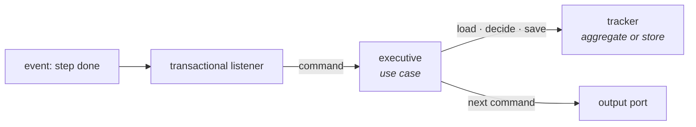

Some flows outlive one transaction: they take several steps, wait for an answer, and pick the next step from what
happened. Two patterns carry them, and they are often confused.

| | Saga | Process manager |
|---|---|---|
| Origin | Garcia-Molina and Salem (1987): a long-lived transaction split into steps that commit one by one | Hohpe and Woolf, *Enterprise Integration Patterns*: a central unit that keeps the state of a sequence |
| Its job | **compensate**: when a step fails, a compensating step undoes each earlier one in the business sense | **decide**: the next step depends on the result of the last |
| Starts | implicitly, on one event | explicitly, with an identity of its own |
| Shape | maps events to commands, linear | holds state and branches |

Vlad Khononov's test separates them: a saga that contains `if`-`else` to choose its next action is a process manager.
Vaughn Vernon avoids the word saga and speaks of a *long-running process*. The rest of this section uses process
manager for the deciding kind and saga only where a step is compensated.

**A process manager is a use case and a tracker, not a new layer.** Vernon calls the two parts the *executive* and
the *tracker*:

- **The executive is a use case.** It loads the tracker, decides the next step, records it, and issues the step's
  command through an output port.
- **The tracker holds the progress.** It is an aggregate with the process's identity — or, where the process has no
  invariant of its own, a store. Every event the process reacts to carries that identity.
- **Each step is a reaction.** A step's outcome arrives as an event; a transactional listener turns it into a
  command for the executive (see [Reacting to an event](#reacting-to-an-event)). One step, one transaction.

Vernon's simplest form needs no separate tracker: the aggregate that does part of the work is the tracker, and its
events drive the next step. Use it where one aggregate naturally holds the progress.

A process that runs in one process and needs no durable state — a loop over steps that a person or a job starts and
waits for — is one use case that calls its steps through output ports. That is the
[flow that needs a second operation](/guide/rules/operation-boundaries-and-declared-contracts.md), repeated.

**A saga does not repair a wrong aggregate boundary.** Only the data inside one aggregate is consistent at once.
Two changes that must always hold together belong in one aggregate, not in a saga that compensates the second
when the first fails.
